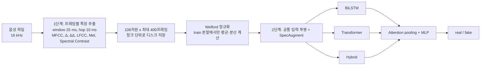
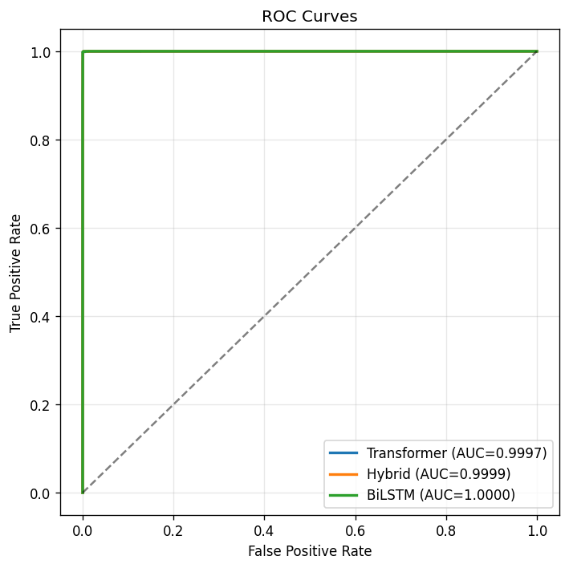

# 딥페이크 음성 탐지: 다중 음향 특징 + 시퀀스 모델 비교

공개 음성 데이터에서 실제 음성(real)과 합성 음성(fake)을 구분하는 졸업논문 프로젝트입니다. 프레임마다 6종 음향 특징을 뽑아 106차원 벡터로 결합하고(1단계), 같은 입력과 학습 조건에서 BiLSTM, Transformer, Hybrid(BiLSTM + Transformer) 분류기를 비교했습니다(2단계).

- 작성자: 이은정, 순천향대학교 컴퓨터공학과 졸업논문 (개인 연구: 전처리, 특징 설계, 모델 학습, 평가)
- 기간: 2025.09.15 ~ 2025.11.04 (연구·실험)
- 사용 기술: Python, PyTorch, librosa, scikit-learn

| 항목 | 내용 |
|---|---|
| 평가 대상 | 자체 구성 데이터의 테스트 분할 15,891건 (real 4,789 / fake 11,102) |
| 주요 결과 | BiLSTM Macro F1 0.9990, EER 0.082% (위 테스트 분할 한정) |
| 저장소에 있는 것 | 실험 노트북 5개, v4 실험 요약 JSON, 결과 그림, 정규화 통계(`seq_scaler_v3.pkl`), 논문 원고(docx) |
| 저장소에 없는 것 | 음성 데이터, 학습된 모델 가중치, 추출한 특징 청크 |
| 일반화 | 확인하지 않음. 분할이 파일 단위 무작위라 화자·코퍼스 누수 가능성이 있습니다([한계](#한계)) |

## 목차

- [문제와 접근](#문제와-접근)
- [데이터](#데이터)
- [특징 추출](#특징-추출)
- [모델과 학습 설정](#모델과-학습-설정)
- [결과](#결과)
- [수치의 출처](#수치의-출처)
- [한계](#한계)
- [재현 방법](#재현-방법)
- [저장소 구조](#저장소-구조)
- [관련 저장소](#관련-저장소)

## 문제와 접근

한 가지 특징만 쓰면 합성 방식에 따라 놓치는 흔적이 생길 수 있어, 성격이 다른 특징(켑스트럼, 선형 필터뱅크, 스펙트럼 대비)을 같은 프레임 격자에서 함께 쓰고 시퀀스 모델로 시간 패턴을 학습하도록 구성했습니다.



## 데이터

`notebooks/data_combine.ipynb`에서 확인한 데이터 구성입니다.

| 출처 | 노트북에서 확인한 사용 방식 |
|---|---|
| ASVspoof 2019 LA (Kaggle 미러 `awsaf49/asvpoof-2019-dataset`) | train, dev, eval의 프로토콜 파일로 bonafide는 REAL, spoof는 FAKE로 옮겨 합침 |
| LibriSpeech train-clean-100 | REAL 데이터로 추가 (`data_combine.ipynb` 셀 2~3) |

실험 데이터는 Kaggle에서 받았습니다(작성자 확인). 이전 README에 있던 "ASVspoof 2021"은 저장소 노트북에서 읽는 코드를 찾지 못해 이 문서에서 뺐습니다.

- 분할: REAL, FAKE 폴더별로 파일 목록을 섞은 뒤(`random.seed(42)`) 8:1:1로 나눴습니다(`data_combine.ipynb` 셀 10~11). 화자나 원본 코퍼스 기준 분할은 하지 않았습니다.
- 규모(v4 노트북 셀 5 출력): train 127,113 / val 15,888 / test 15,891, 합계 158,892. 세 분할 모두 real:fake 약 1:2.32.
- 이용 조건: ASVspoof 2019와 LibriSpeech는 각 배포처의 이용 조건을 따릅니다. 이 저장소는 데이터를 포함하지 않습니다.

## 특징 추출

모든 특징은 같은 STFT 설정(n_fft 512, window 400 = 25 ms, hop 160 = 10 ms, 16 kHz)을 써서 프레임이 자동으로 정렬됩니다. 최대 길이는 400프레임(4초)입니다.

| 특징 | 차원 | 넣은 이유(노트북 주석 기준) |
|---|---|---|
| MFCC | 13 | 음소와 음색 |
| MFCC Delta | 13 | 1차 시간 변화 |
| MFCC Delta-Delta | 13 | 2차 시간 변화, 합성음의 시간적 불연속 |
| LFCC | 20 | 선형 필터뱅크로 고주파 보코더 흔적 |
| Mel-Spectrogram | 40 | 시간-주파수 에너지 분포 |
| Spectral Contrast | 7 | 대역별 봉우리-골 대비 |
| 합계 | 106 | 프레임당 벡터 |

메모리 제약(RAM 15 GB, 학습 특징 약 31 GB)을 다루기 위해 특징을 청크 단위로 디스크에 저장해 순차 로드하고, 정규화 통계는 Welford 알고리즘으로 train 분할에서 한 번에 계산했습니다(v4 셀 10~11). 노트북 주석에 따르면 `np.concatenate`나 `partial_fit`은 내부 버퍼 할당으로 메모리가 부족했습니다.

## 모델과 학습 설정

세 모델은 입력 투영, SpecAugment, attention pooling, MLP 분류기를 공유하고 시퀀스 인코더만 다릅니다.

| 모델 | 인코더 | 파라미터 수 (v4) |
|---|---|---|
| BiLSTM | 양방향 LSTM, hidden 256, 3층 | 4,466,563 |
| Transformer | Pre-LN, d_model 256, head 8, 4층, FFN 512 | 2,186,755 |
| Hybrid | BiLSTM(hidden 128, 2층) 뒤 Transformer 2층(d_model 256, head 8) | 1,778,051 |

학습 설정(`deepfake_2stage_detection_v4.ipynb` 셀 3, 17, 19 기준):

- 손실: 클래스 가중 cross-entropy, 학습 로더는 `WeightedRandomSampler`(역빈도 가중치)
- 옵티마이저: AdamW, lr 1e-4, weight decay 1e-4
- 스케줄러: CosineAnnealingWarmRestarts(T_0 10, T_mult 2)
- 조기 종료: 검증 Macro F1 기준, patience 20, 최대 100 epoch
- AMP(GradScaler), gradient clipping max_norm 1.0
- SpecAugment: time mask 30, freq mask 20 (학습 시에만)
- seed 42, 배치 64

이전 README의 BiLSTM 2층, weight decay 1e-2, patience 10, freq mask 10은 v4 코드와 다릅니다(freq mask 10은 v2 노트북 값). 논문의 최종 학습 설정은 위 v4 설정과 같습니다(작성자 확인).

## 결과

v4 노트북 실행 결과이며 `results/experiment_summary_v4.json`에 저장된 값과 같습니다. 평가 대상은 위 데이터의 test 분할 15,891건입니다.

| 모델 | Accuracy | Macro F1 | AUC | EER (%) | ECE | 오분류 |
|---|---|---|---|---|---|---|
| BiLSTM | 0.9992 | 0.9990 | 1.0000 | 0.082 | 0.0008 | 13 / 15,891 |
| Hybrid | 0.9992 | 0.9990 | 0.9999 | 0.111 | 0.0008 | 13 / 15,891 |
| Transformer | 0.9985 | 0.9982 | 0.9997 | 0.145 | 0.0014 | 24 / 15,891 |

추가 분석(같은 노트북):

- McNemar 검정(정확 이항): Transformer vs BiLSTM p = 0.0127, Transformer vs Hybrid p = 0.0074, Hybrid vs BiLSTM p = 1.0000. 같은 테스트 분할에서 BiLSTM과 Hybrid의 차이는 확인되지 않았습니다.
- BiLSTM 정확도의 Wilson 95% 구간: [0.9986, 0.9995]
- BiLSTM 5-fold 교차검증: train 127,112건 중 **5,000건을 뽑은 서브샘플**에서 fold당 20 epoch로 실행. fold별 Macro F1 0.990, 0.988, 0.985, 0.976, 0.991 (평균 0.986). 전체 데이터 학습 결과와 조건이 다르므로 같은 표에 섞어 비교하지 않습니다.

<p align="center">
  
</p>

`results/figures/`의 `fig_*.png`는 v4 노트북, `*_2stage.png`는 v2/final 노트북에서 저장한 그림입니다.

## 수치의 출처

| 수치 | 출처 |
|---|---|
| Accuracy, Macro F1, AUC, EER, 오분류 | `results/experiment_summary_v4.json`, v4 셀 23~33 |
| ECE, McNemar, 5-fold | v4 셀 29, 34, 37 출력 |
| 파라미터 수 | v4 셀 17 출력 |
| 추론 지연 | v2 셀 33 출력: Transformer 19.15 ms, BiLSTM 47.97 ms, Hybrid 41.27 ms (배치당). **v2의 Hybrid는 1,923,587 파라미터로 v4와 구조가 다르고**, v4에서는 지연을 다시 재지 않았습니다 |

`deepfake_2stage_detection_final.ipynb`와 `deepfake_final.ipynb`에는 특징 추출 출력만 남아 있고 학습·평가 출력은 없습니다. 위 결과는 v4 노트북에서 나왔습니다.

## 한계

- **분할 누수 가능성**: 파일 단위 무작위 분할이라 같은 화자, 같은 공격 방식의 음성이 train과 test에 함께 들어갈 수 있습니다. ASVspoof 공식 train/dev/eval 분할(eval에 학습 때 없던 공격 포함)을 쓰지 않았습니다.
- **코퍼스 차이**: real에는 LibriSpeech가 추가됐지만 fake는 ASVspoof에서만 왔습니다. 모델이 진위 대신 녹음 환경이나 코퍼스 차이를 학습했을 가능성을 배제하지 못했습니다.
- 외부 데이터, 한국어 음성, 새로운 합성 방식에 대한 성능은 측정하지 않았습니다.
- 학습된 가중치가 저장소에 없어 결과를 바로 재현할 수 없고, 데이터를 다시 구성해 학습해야 합니다.
- 노트북에 작성 당시의 절대 경로(`C:\Users\ipl\...`)가 남아 있고, 일부 셀 출력의 한글이 깨져 있습니다.

## 재현 방법

데이터와 가중치가 없으므로 아래 순서로 직접 다시 만들어야 합니다. 이번 정리에서 노트북을 다시 실행하지는 않았습니다.

1. 환경 준비 (작성 당시 환경)

   | 항목 | 버전 |
   |---|---|
   | OS | Windows 11 |
   | Python | 3.10 (Conda) |
   | PyTorch | 2.5.1 + CUDA 12.1 |
   | librosa | 0.11.0 |
   | scikit-learn | 1.7.2 |
   | numpy / scipy | 2.0.1 / 1.15.2 |
   | GPU / RAM | RTX 4070 Ti 12 GB / 15 GB |

   ```bash
   pip install torch torchaudio librosa scikit-learn numpy scipy pandas matplotlib seaborn tqdm joblib pydub soundfile
   pip install kagglehub
   python -c "import kagglehub; print(kagglehub.dataset_download('awsaf49/asvpoof-2019-dataset'))"
   ```

   LibriSpeech train-clean-100은 OpenSLR에서 따로 받습니다.

2. `notebooks/data_combine.ipynb`: 셀의 절대 경로를 내려받은 위치로 바꾼 뒤 REAL/FAKE 통합, 형식 변환, 8:1:1 분할을 실행합니다. 결과는 `DATASET/{train,val,test}/{real,fake}` 구조여야 합니다.
3. `notebooks/deepfake_2stage_detection_v4.ipynb`: `BASE_DIR = 'DATASET'` 기준으로 특징 추출, 정규화, 세 모델 학습, 평가, 추가 분석을 순서대로 실행합니다. 마지막 셀이 `experiment_summary_v4.json`을 저장합니다.

별도의 설정 파일은 없고 경로와 하이퍼파라미터는 노트북 셀 상수로 지정되어 있습니다.

## 저장소 구조

```
Capstone-Project/
├── notebooks/
│   ├── data_combine.ipynb                     # 데이터 통합, 형식 변환, 8:1:1 분할
│   ├── deepfake_2stage_detection_v2.ipynb     # 초기 비교 실험 (추론 지연 측정 포함)
│   ├── deepfake_2stage_detection_v4.ipynb     # README 결과의 출처 (학습, 평가, 통계 검정, 5-fold)
│   ├── deepfake_2stage_detection_final.ipynb  # 정리본 (특징 추출 출력만 남아 있음)
│   └── deepfake_final.ipynb                   # 정리본 + 데이터 시각화 코드
├── results/
│   ├── experiment_summary_v4.json             # v4 지표
│   └── figures/                               # ROC, 혼동 행렬, 신뢰도 그림 등
├── models/
│   └── seq_scaler_v3.pkl                      # train 분할의 채널별 평균·표준편차 (가중치 아님)
├── 음성 딥페이크 탐지를 위한 2단계 딥러닝 시스템.docx   # 논문 원고
└── README.md
```

## 관련 저장소

- [deepfake-voice-detector](https://github.com/Roooselina/deepfake-voice-detector): 같은 주제의 Android 앱 + Flask 서버 팀 프로젝트입니다. 그 서버의 모델은 MFCC 13차원 기반 3클래스 분류기로, 이 저장소의 BiLSTM 모델과 다릅니다.

## 논문

Lee EunJeong, "A Two-Stage Deep Learning System for Audio Deepfake Detection," B.Eng. thesis, Soonchunhyang University, 2026.

## 라이선스

코드와 문서는 [MIT License](LICENSE)를 따릅니다. ASVspoof 2019, LibriSpeech 등 데이터셋은 이 라이선스에 포함되지 않으며 각 배포처의 이용 조건을 따릅니다.
